# SOMAS v1.2 architecture and research notes

## Runtime

```mermaid
flowchart LR
    Browser -->|same-origin cookies + CSRF| Pages[Cloudflare Pages frontend]
    Pages --> Gateway[Pages Functions /api/*]
    Gateway -->|HTTPS + private proxy secret| API[FastAPI on Render]
    API -->|SQLAlchemy async / psycopg 3 / TLS| PG[Neon PostgreSQL]
    API --> Encoder[Deterministic feature encoder]
    Encoder --> Manager[Manager-owned NumPy filter]
    Manager --> Plan[Validated organization graph]
    Plan --> Workers[Specialist-owned NumPy filters]
    Workers --> Drafts[Simulated plans or explicit AI drafts]
    Drafts --> Human[Human-verified corrections]
    Human -->|bounded SGD; version compare-and-set| PG
```

Static assets live in `frontend/`; `functions/api/[[path]].js` is only an API gateway. Python, NumPy, training, and all database operations run on Render. All durable state lives in PostgreSQL. SQLAlchemy's async engine uses psycopg 3, at most five pooled connections per process, pre-ping, disabled prepared statements for pooler compatibility, and transaction-local statement/lock timeouts. Remote connections require TLS.

Alembic is the only schema-management path. `0001_v12` contains frozen PostgreSQL DDL; it does not import evolving runtime models. Startup checks the Alembic revision. Deployment runs migrations before Uvicorn; a transaction-scoped PostgreSQL advisory lock serializes migrations. Runtime schema creation and SQLite/MongoDB fallbacks do not exist.

## Relational schema

| Table | Purpose and integrity |
|---|---|
| `users` | Normalized unique email, salted PBKDF2 hashes, session epoch |
| `sessions` | Hashed token primary key, owner FK, expiry, CSRF, epoch |
| `organizations` | Human owner, Manager reference, business/plan JSONB, status |
| `memberships` | Organization + person membership, owner/editor/viewer role constraint |
| `departments` | Manager-defined department names/configuration per owner/org |
| `agents` | Composite owner/agent identity, owner/org/department FKs, config JSONB |
| `relationships` | Reporting/review edges between owned agents |
| `policies` | Owner/agent key, current version, compressed NumPy weights as BYTEA |
| `policy_versions` | Immutable version snapshots with weight bytes and timestamp |
| `runs` | Owner/org FK, mode, status, outputs JSONB |
| `feedback` | Owner/org/optional specialist FKs, labels, verification, trained version |
| `conversations` | Owner/org/run, sender/receiver, actual planning context messages |
| `decisions` | Manager/worker filter decisions with owner/org/agent/run context |
| `audit_logs` | Account-scoped application events; no credentials |
| `rate_limits` | Hashed fixed-window abuse counters with expiry |

Each user owns an explicit Manager agent with ID `root_manager` within that user's composite namespace, even before creating a business. Specialists have separate policies. Organizations create an owner membership automatically; APIs intentionally retain v1.1 owner-only access. Sharing/invitation workflows are not implemented. Schema roles alone grant no API access.

All business reads, updates, training, lists and exports require the authenticated owner ID. Composite foreign keys prevent an agent, run or feedback record from claiming another owner's organization. Graph creation inserts the organization, departments, specialists, policies, relationships, Manager decision and event in one transaction. Foreign IDs receive 404 without confirming their existence.

Training computes gradients off the event loop, then uses `UPDATE ... WHERE version = expected_version` inside the same transaction as the immutable snapshot, feedback and audit event. A stale update raises HTTP 409 and rolls back bookkeeping. It does not silently overwrite another correction. Reorganization gives new specialists independent copies of matching old weights and retains their learned version.

Runs save drafts, status, worker decisions, conversations and audit event in one transaction. The Manager's task assignments are recorded as planning messages. AI runs also record the previous four draft excerpts actually supplied to each next specialist. Demo outputs remain simulations; no real research or business actions are claimed. The execution loop is sequential, not a dependency scheduler.

## Neural core and scientific limits

The existing network and serialization are preserved: 128 deterministic signed hashed text features plus 12 business-state values, linear `140 → 48`, tanh, linear `48 → K`, sigmoid. Manager K=13 yields 7,405 parameters; worker K=6 yields 7,062. Each agent's NumPy weight matrices are compressed separately. The frozen LLM receives guidance, not gradients or direct weight access.

Cold-start heuristics blend with neural predictions; selected capabilities are constrained by a finite catalog. Safety flags are deterministic checks outside the learned routing. Verified labels trigger supervised binary cross-entropy SGD, not automatic online reinforcement learning. Training iterations are fixed (250 Manager, 200 worker); LLM calls use a 15-second network timeout and no external tools. Only explicit AI mode can incur API charges. Request deadlines and user-visible errors bound the free-tier request path; interrupted writes must be checked in history before retrying.

The hypothesis is that learned pre-LLM controllers improve organizational routing over fixed workflows. It remains unproven. Necessary comparisons include fixed templates, heuristics, LLM-only routing, retrieval memory, and learned filters under identical tasks/budgets. Evaluate held-out business domains and later timelines using task success, capability selection, latency, cost, unnecessary agents, policy errors and forgetting. No worldwide legal coverage, novel scientific result, or measured performance advantage is claimed.

## Browser and deployment security

The browser calls only the Pages origin. Pages Functions accepts only `/api/*`, fixes destinations to the configured HTTPS `*.onrender.com` origin, disallows credentials/path/query in that origin, forwards cookies and CSRF, blocks redirects, strips hop-by-hop/CORS response headers and cookie Domain overrides, and disables private response caching. Local HTTP is available only with explicit `ALLOW_LOCAL_BACKEND=1`. Static CSP and XSS escaping remain intact.

The proxy overwrites client identity and gateway-secret headers. Render verifies a shared 32+ character secret before serving API traffic and compares mutating browser Origins against an exact allowlist. Cookies are HttpOnly, Secure on HTTPS, SameSite=Strict, Path=/, with no Domain override. No credentialed cross-origin CORS is enabled. Forwarded protocol headers are not blindly trusted; Render uses `SOMAS_SECURE_COOKIES=1` and Uvicorn disables proxy-header trust.

Passwords retain salted PBKDF2-HMAC-SHA256 with 600,000 iterations, executed in a worker thread. Sessions store only token hashes, expire after seven days, and are checked against the user's session epoch. Password updates lock out concurrent session issuance and atomically revoke existing sessions. Login/signup and account request limits live in PostgreSQL; expired counters are cleaned opportunistically. JSON input is capped at 32 KiB and paginated reads at 100 rows. Request logs contain only status and duration, not URL queries, email, business text or secrets; SQLAlchemy hides bound parameters.

Isolation is application authorization plus database constraints, not PostgreSQL row-level security. Do not grant users direct database access. The deployment role must manage schema for startup migrations; a separately privileged migration role and restricted runtime role would further reduce privileges. No production security audit, email verification, recovery provider, shared invitations, external connectors or continuous background execution is included. Monitor free-tier database growth from immutable policy snapshots and histories.

## Legacy migration

`scripts/migrate_sqlite_to_postgresql.py` is an explicit offline administration tool, not live persistence. It validates ownership and neural blob versions before writing, opens the source read-only, rejects v1.0 unowned data, and recreates normalized memberships/departments/graph records. A single transaction imports at most 10,000 derived rows. Repeated imports compare existing content; conflicts abort without overwriting. Existing hashed sessions and passwords survive. Only weight versions present in v1.1 can be imported; absent historical snapshots cannot be invented.
