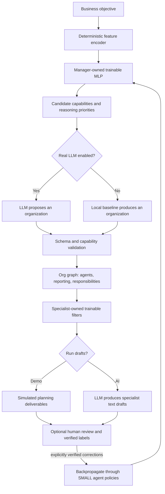

# SOMAS 1.1 — Architecture & Research Notes

## Working claim (not proven novelty)

A Manager with its own lightweight neural filter and a frozen LLM could learn to choose organizational capabilities and structures more efficiently than a fixed multi-agent workflow. Worker specialists maintain their own independent trainable neural policies. This is a **hypothesis**, not a scientific conclusion.

## Runtime flow

## Actual neural network

- Input: 128-dimensional deterministic hashed text features; 12 numeric/categorical business state features.
- Architecture per policy: linear 140→48, tanh, linear 48→K, sigmoid; K=13 for Manager capability labels and K=6 for workers' strategy labels.
- Manager trainable parameter count: 140×48 + 48 + 48×13 + 13 = **7,405**.
- Worker trainable parameter count: 140×48 + 48 + 48×6 + 6 = **7,062**.
- Data storage: SQLite BLOB of NumPy compressed matrix values; independent weights per agent ID.
- Train: manually verified capability corrections → multilabel binary cross-entropy → analytic backpropagation / SGD; worker strategy label → same learning function.
- The frozen LLM does not receive any gradient updates and has no direct access to the neural weights.
- No API key is needed to train and use these independently owned policies.

## Explicit separation of responsibilities

**Manager**: proposes and ranks capability requirements; selects organizational structure; delegates responsibilities; later reorganizes.

**Small trainable neural filter**: produces context-dependent guidance to the Manager before an LLM call. It is not a language generator and cannot reason about an unlimited capability vocabulary.

**Optional LLM**: generates detailed structured organization proposals and specialist work drafts when configured. It is not permitted to use external actions or grant authority.

**Policy / validation layer**: caps agent count, constrains allowed capabilities, requires compliance review for deterministic risk flags, records work as drafts, never executes external actions.

**Learning engine**: updates separately versioned neural policies only after explicit human-verified corrections.

## Learning limits

The current feedback method is a minimal but *real* supervised gradient update. It is not reinforcement learning and is not automatic online improvement from verified business outcomes. Evaluation after a single label is prone to overfitting. Real continual specialization must add an experience replay dataset, validation splits, aggregate uncertainty metrics, positive/negative outcome attribution, leakage prevention, and per-business isolation.

## Experimental baselines before claiming an invention

1. Fixed capability templates.
2. Local heuristic capability routing (already included).
3. Frozen LLM-only Manager (available with key by disabling learned routing experimentally).
4. Frozen LLM with long-term retrieval memory.
5. Trainable Manager filter with identical task data and token budgets.

Split evaluation by business domain and timeline. Metrics: held-out task success, correct role selection, task latency, total LLM cost, unnecessary agent count, policy/regulatory errors, and catastrophic forgetting. No performance improvements are claimed here.

## Business breadth

The architecture allows different team sizes, industry goals and geographic metadata, but a finite initial capability taxonomy is not exhaustive. Building for worldwide businesses requires locale-specific knowledge, laws, language evaluation, integrations, entity permissions, audit infrastructure, and verified human oversight.

## Version 1.1 priorities

- Benchmark data creator and independent evaluation harness.
- Experience replay and incremental learning without catastrophic forgetting.
- Domain-specific capability registries and organization schemas.
- Project graph dependency planning rather than purely sequential draft execution.
- Read-only connectors and authenticated permissions followed by human-gated write actions.
- Multi-tenant storage, isolation, explicit consent, monitoring, rate limits, and audit exports.
- Model-independent LLM adapters, local model support, and real-time streaming.
- Dynamic agent spawning / modular expansion with measurable threshold to justify complexity.

## Research context

This prototype is related to self-organizing multi-agent systems, lightweight pre-LLM neural controllers, dynamic communication graphs and offline policy learning. Similar ideas appear in work such as G-Designer, HarnessMDP and MetaCtrl. The overall concept should **not** be marketed as scientifically unprecedented without a rigorous literature review and comparative experiments.

---

## v1.1: User ownership and neural policy isolation

### Human user and AI agent are different entities

`users` represent authenticated people; each owns a private SOMAS workspace. The root Manager is an AI agent whose policy key is `root_manager` **within that user's namespace**. Its neural policy is not global. Specialist agents have independent IDs and policies belonging to the same user.

`users → orgs → agents → policies` is the ownership model. `runs`, `feedback`, and `events` are also scoped to the human owner.

The Manager is responsible for creating a suitable organization for its owner, not giving itself server permissions. User authentication happens before the business request enters the Manager.

### Database invariants

- Every workspace query has a required `user_id` filter.
- `(user_id,org_id)` has a composite foreign key for agent, run and feedback rows so an agent cannot claim another owner's org.
- Policies are keyed by `(user_id,id)` rather than by globally accessible policy name.
- Unauthorized lookups return `404` for foreign organization and agent IDs without disclosing their existence.
- Password hashes use per-user PBKDF2 salts; opaque session tokens are stored only as SHA-256 hashes.
- Cookie-authenticated write requests are verified with a session-specific CSRF header.

### Limitations

This is account isolation for a local MVP, not enterprise multitenancy. Users cannot share an org and there is no platform administrator role. SQLite provides no production row-level security, email verification or multi-node session infrastructure. Session brute-force controls are process-local; external, persistent controls are required for internet deployment.
