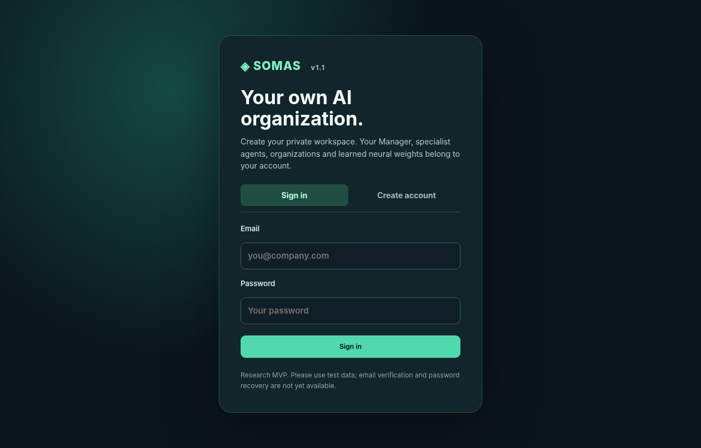

# SOMAS MVP v1.1 — Private AI Agent Workspaces

**Self-Organizing Multi-Agent System**: a local research MVP in which the Manager designs an AI team around a business problem. Each *registered human user* gets their **own Manager policy, organizations, specialist agents, runs, feedback, and trainable neural weights**. This is an upgrade of the SOMAS v1.0 codebase, not a replacement project.



> **Security scope:** SOMAS v1.1 is suitable for local demonstrations and further development. Although authentication, basic CSRF defense and account-data isolation are implemented and tested, **it is not security-audited or ready to serve real businesses over the public internet**. Email verification, password recovery, tenant/business invitations, durable distributed rate limiting, TLS configuration, production deployments, and compliance infrastructure remain future work. Use synthetic/test data.

## What changed in v1.1

- **Register and sign in** with an email, display name and password (minimum 12 characters).
- **Session cookies** are opaque, stored as SHA-256 hashes in the database, HttpOnly, SameSite=Strict, with seven-day expiration; support `SOMAS_SECURE_COOKIES=1` when behind HTTPS.
- **Passwords** stored using per-user random salts with PBKDF2-HMAC-SHA256 (600,000 iterations), never plaintext.
- **CSRF check** for cookie-authenticated write endpoints; client obtains the CSRF token from the authenticated session response.
- **My Agents** tab: private directory of all specialists created in the signed-in user's organizations, with their current neural-policy versions.
- **Private policy weights**: Manager policy is keyed per account; every specialist policy is keyed to its owner. Training one user's policy does not affect another user's neural weights.
- **Ownership enforcement** across every organization, agent, execution run, training-feedback event, export and activity record. A different account receives `404` for someone else's object IDs.
- **Account settings**: change display name or password; password change invalidates all active sessions.
- Existing v1.0 organization design, worker policy training, simulation and optional LLM drafting remain.

## Quick start (Python 3.10+)

Download or clone the project and open a terminal in the repository folder.

**Windows PowerShell:**

```powershell
py -m venv .venv
.venv\Scripts\Activate.ps1
pip install -r requirements.txt
python run.py
```

Alternatively double-click `start_windows.bat`.

**macOS / Linux:**

```bash
python3 -m venv .venv
source .venv/bin/activate
pip install -r requirements.txt
python run.py
```

Open **http://127.0.0.1:8000**. Choose **Create account** and sign in. Each new user starts with no organizations and independent initial policies. Agents are created for that user when their Manager designs an organization.

### Try two separate users

1. Create account Alice, then create and train a team in the Organization Studio.
2. Sign out; register Bob in the same browser.
3. Bob's **My Agents**, organization history, activity log and Manager policy begin empty/untrained.
4. Bob cannot fetch, run, export or train Alice's agents using Alice's object IDs.
5. Sign in as Alice again: her own organizations and previously trained weights are still there.

## Neural architecture and limitations

- Manager: tiny NumPy neural filter (~7.4K parameters) for capability-selection preferences, independent of the frozen LLM.
- Specialist: separate tiny NumPy neural filters (~7K parameters per worker) for preferred behavior, independent across users and agents.
- Demo mode is local and creates *simulated plans*, never real business actions.
- Optional LLM integration uses a single **server-configured** `OPENAI_API_KEY`; it is not billed or restricted per user and is intended only for trusted local development. Do not publish this version publicly with a funded API key.
- Learning uses explicitly verified corrections, not independently verified business outcomes or continual reinforcement learning. More research is required.

## Optional AI planning

Use `OPENAI_API_KEY` and optionally `OPENAI_MODEL` as server environment variables. Do not include credentials in Git. For example:

```powershell
$env:OPENAI_API_KEY = 'your-own-private-key'
$env:OPENAI_MODEL = 'gpt-4.1-mini'
python run.py
```

## Local database and upgrading from v1.0

By default v1.1 creates **`data/somas_users.db`** (and stores all user sessions, organizations and neural policies there). **Do not publish or share the `data/` directory**; it contains personal account data and business records.

Existing v1.0 used `data/somas.db`, which had no account owner information. **v1.1 never assigns that legacy data to a newly registered user automatically.** It leaves the old file untouched and starts with a separate database. If you set `SOMAS_DB` to an old v1.0 file, startup intentionally fails instead of exposing unowned historical data. A reviewed, owner-authorized migration utility would be needed to import v1.0 history.

Changing/removing a user's registration does not remove the older database or the records from other users.

## Running tests

```bash
python -m pytest -q
```

Includes data-isolation checks across accounts, tests for forged object IDs, session/CSRF protection, password changes and reauthentication, plus the original neural-policy and organization tests. Browser rendering is not required to run the tests.

## API highlights

All organization and agent routes require an authenticated session.

| Endpoint | Description |
|---|---|
| `POST /api/auth/register` | Create user + session |
| `POST /api/auth/login` | Sign in |
| `GET /api/auth/me` | Current user + CSRF token |
| `POST /api/auth/logout` | End current session |
| `PATCH /api/auth/profile` | Change display name |
| `POST /api/auth/change-password` | Change password, revoke all sessions |
| `GET /api/agents` | All specialist agents owned by current user |
| `GET/POST /api/organizations` | Private list / create an organization |
| `GET /api/organizations/{id}` | Private organization details |
| `POST /api/organizations/{id}/reorganize` | Generate a new private organization version |
| `POST /api/organizations/{id}/run` | Simulated or AI-draft planning |
| `GET /api/organizations/{id}/runs` | Private execution history |
| `POST /api/organizations/{id}/feedback` | Train the account's own Manager |
| `POST /api/organizations/{id}/agents/{agent_id}/feedback` | Train one of the account's specialists |
| `GET /api/organizations/{id}/export` | Export only owner's data |
| `GET /api/events` | Private activity log |

API documentation: `/docs` (interactive endpoint calls still require authentication and CSRF tokens).

See [ARCHITECTURE.md](ARCHITECTURE.md), [RELEASE_NOTES.md](RELEASE_NOTES.md), and [GITHUB_PUBLISH.md](GITHUB_PUBLISH.md).
